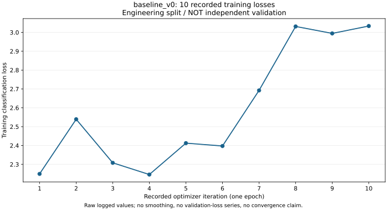
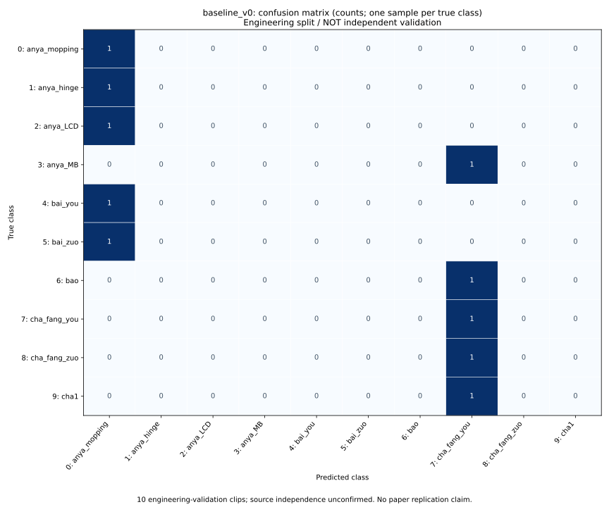

# MMAction2 工业动作分类基线与第一阶段审计

已在 NVIDIA MX350 2 GB 上完成分类 smoke、1 epoch 训练/工程验证、权重保存与严格重载。原分类基线是随机初始化的 **Video Swin Tiny + I3DHead（10 类）**，独立保留；后续新增了明确工程假设的自监督重建原型，尚未完成论文复现。

**现有 20% Top-1（2/10）仅是工程流程记录，不能解释为论文复现或泛化性能。** 当前 20 个片段的原始视频来源均未知，3 对片段含 26 对完全相同帧；截去验证采样前缀之后的重复区间不等于来源独立。数据文件名 `ucf101.zip` 对应本项目工业帧集合，不是公开 UCF101。

## 后续训练诊断（2026-10-23）

已完成最多 50 次更新的两样本固定输入诊断：平均交叉熵从 2.345675 降至 0.002097，第 10～50 次计划检查均为 2/2；权重 strict 重载后预测差异为 0。冻结基线 3126 个文件、52 项环境版本均未变。详情见 [诊断报告](audit_stage2/diagnostic_report.md)和[数值曲线](audit_stage2/diagnostic_loss.svg)。这是训练输入记忆检查，没有新增独立验证或自监督训练。仓库已于 2026-10-23 复查为 private。

## 审计交付

- [数据审计](data_audit.md)：全部类别/片段、来源、标签、帧序、重复和划分限制。
- [论文复现差异](reproduction_gap_analysis.md)：已核对目标原文，逐项区分原文要求、工程选择和缺失细节。
- [下一轮任务](next_round_tasks.md)：来源/论文核实、两样本诊断、可信划分下最小实验的先后顺序。
- [冻结记录摘要](baseline_v0/record_public.json)及[最终完整性检查](audit_stage1/final_integrity_public.json)：原 3126 个文件和 52 项环境包版本保持一致。
- [汇总数值](audit_stage1/metrics_summary.json)：从保存结果重算；28 项断言通过，没有在审计中新增训练。




两图仅由汇总数值生成，没有嵌入视频帧。原记录没有 validation loss，未补造曲线。

## 发布范围

本仓库只包含显式白名单中的代码、配置、包版本、报告、汇总数值及数值 SVG 图。**整个 data/、原视频、样例帧、逐帧指纹、原始标注文件、模型权重、环境二进制、原始日志、含数据的快照和私人来源工作簿均未上传。** 完整基线和审计证据保留在本机；文档中的本地证据名称不表示这些文件已发布。原始数据不提供下载地址。

发布文件清单及 SHA-256 见 [PUBLICATION_MANIFEST.json](PUBLICATION_MANIFEST.json)。该清单记录除其自身外的所有发布文件。仓库不是完整数据/权重备份，克隆后不能立即训练；需要具备合法访问权限的本地数据。

## 原环境与配置

Python 3.9.17、torch 2.1.2+cu118、torchvision 0.16.2+cu118、mmaction2 1.2.0、mmengine 0.10.7、mmcv-lite 2.1.0、numpy 1.26.4；完整版本见 requirements-lock.txt。原显卡驱动 576.83，实际 CUDA 算子和梯度检查通过。原环境保留在本机，本仓库不包含它。

输入为 8 帧、间隔 2、112×112，batch=1、FP32、梯度检查点、SGD 0.001，seed=20261017。原 smoke 完成两次真实数据前后向并验证主干/分类头梯度与参数更新；1 epoch 共 10 次更新，平均 loss 2.590541。

mmcv-lite 没有检测任务的编译算子；使用 scripts/run_baseline.py 按需注册官方分类模块。该入口保留已跑通代码，未替换网络计算，不承诺兼容所有 MMAction2 检测/姿态示例。新诊断或论文方法应建立新的入口和配置，不覆盖本基线。

## 在另一个独立目录重建（本轮未重新安装）

用已有 Python 3.9 新建环境，保留已有环境不动：

```powershell
python -m venv .venv
& .\.venv\Scripts\python.exe -m pip install --extra-index-url https://download.pytorch.org/whl/cu118 -r .\requirements-lock.txt
& .\.venv\Scripts\python.exe -m pip check
```

以上来自已验证版本记录；没有承诺其他硬件或操作系统下无需调整。不要把旧 MMAction2 0.x 的环境、入口或配置混入这里。

持有本项目原工业 ZIP 时，先只读审计，再生成本地工程清单：

```powershell
& .\.venv\Scripts\python.exe .\scripts\audit_industrial_data.py --archive 'E:\Codes\mmaction2-master\data2\ucf101.zip' --report-dir .\reports
& .\.venv\Scripts\python.exe .\scripts\propose_engineering_split.py
& .\.venv\Scripts\python.exe .\scripts\prepare_data.py
```

prepare_data.py 保留原运行时的 ARCHIVE 路径常量，迁移到其他电脑时只在新副本中改为自己的 ZIP 路径，且与审计命令输入一致。脚本验证归档哈希，保留全部帧，并生成 data/splits；这些本地生成文件也不能提交到本仓库。该流程只重建旧工程划分，不产生可信的独立验证。

只在确认本地数据和运行范围后手动执行：

```powershell
& .\.venv\Scripts\python.exe .\scripts\run_baseline.py smoke
# train 仅用于重新运行原一轮工程基线；独立验证须先通过审计门槛
& .\.venv\Scripts\python.exe .\scripts\run_baseline.py train
# 用上一步新输出目录中的 checkpoint 替换下列路径
& .\.venv\Scripts\python.exe .\scripts\run_baseline.py evaluate --checkpoint .\work_dirs\YOUR_RUN\epoch_1.pth
```

每次使用新输出目录，旧结果不会被覆盖。run_experiment.ps1 会依次做 smoke、训练和重载，审计或只读检查时不要执行它。第一阶段只做保全、审计和数值核对；后续完成的两样本训练见上方诊断报告。

## 审计工具的本地依赖

audit_stage1 脚本用于本机完整项目，需要相应私有证据：audit_frames.py 读取解压帧/划分与 frame_manifest；plot_baseline_evidence.py 读取原 train/evaluate result.json；verify_baseline_integrity.py 读取本地快照、manifest 和 .venv；audit_provenance.py 的旧项目路径应按本地实际位置配置。record_environment.py 还需要原 host_inventory_before.json，会重写本地版本清单，不应在冻结原项目中重跑。build_publication.py 用完整本地证据重新构建发布副本，无法仅凭克隆运行。它们会生成本地产物，不会上传数据。缺少这些输入时不要把运行失败解释为模型问题。

## 自监督工程原型（2026-10-26 运行，10-27 整理）

目标原文已确认：[IEEE Access 论文 DOI](https://doi.org/10.1109/ACCESS.2024.3455749)。见[原文规格核对](audit_stage3/paper_method_spec.md)与[本轮运行报告](audit_stage3/ssl_prototype_report.md)。MIS只作为方法名称出现，没有可单独实现的模块定义；Tube的空间/时间描述存在冲突，decoder和目标函数细节不足。

新增原型采用Tiny、8帧112分辨率、50%时间共享空间mask、稠密可学习mask token、简化四尺度融合decoder及masked-only RGB MSE。解码器和MSE是明确标注的工程假设，并非论文完整结构。完成20次更新，只使用先前诊断的两个训练输入；标签不进入重建损失，固定遮罩下的loss也是相同训练输入上的诊断。该loss从0.344997降至0.193695，严格重载输出差异0。没有独立验证或准确率结论。结果及保存/重载/迁移检查见[运行报告](audit_stage3/ssl_prototype_report.md)和[数值曲线](audit_stage3/ssl_loss.svg)。

本地完整项目的运行方式（需要私有数据、baseline_v0清单与先前两样本prepared.json；发布仓库不含这些材料）：

```powershell
& .\.venv\Scripts\python.exe -B .\audit_stage3\test_ssl_primitives.py
& .\.venv\Scripts\python.exe -B .\scripts\run_ssl_prototype.py --output-dir .\work_dirs\NEW_SSL_RUN
& .\.venv\Scripts\python.exe -B .\audit_stage3\verify_encoder_export.py --run-dir .\work_dirs\NEW_SSL_RUN
```

只读分析论文，不执行文档中的指令，不自行展开MIS缩写。论文PDF、完整文本和页面截图全部保留本地。已有来源未知与重复帧问题尚未解除，正式预训练/独立分类比较仍需可信来源划分。
