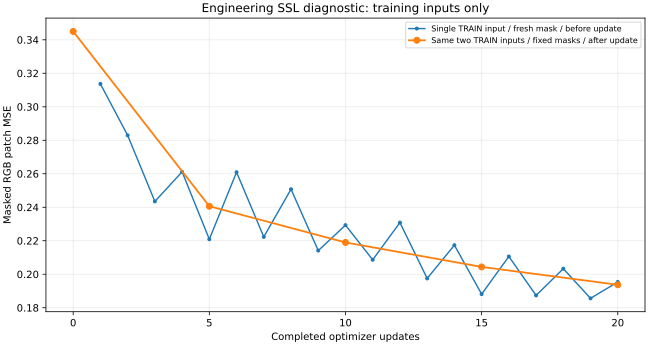

# 自监督重建工程原型：20 次更新记录

训练日期：2026-10-26。报告日期：2026-10-27。运行：`ssl_proto_20261026_01`。

**前向、反向、遮挡隔离、权重保存与分类主干迁移检查通过。** 本轮采用明确列出的工程假设，只验证实现链路；不等于 E-VIST/MIS 完整复现，没有测量独立分类性能。

## 本次做了什么

保留原 MMAction2 分类基线及两样本诊断结果，新增独立配置和重建模型。从随机初始化开始，只用此前已检查的两个固定 TRAIN 输入，交替进行 20 次 AdamW 更新，批次为 1。时间采样和裁剪固定，每次更新重新生成遮挡；每 5 次更新在同样两个 TRAIN 输入上，使用固定遮挡及 eval 模式计算平均重建误差。没有使用独立验证集，重建损失不使用类别标签。

输入为 8 帧、112×112 RGB。2×4×4 patch 得到 4×28×28=3136 个 token，每次精确遮挡 1568 个。空间遮挡图案跨时间共享，三个 RGB 通道一起遮挡。目标为分块后的 RGB/255，目标张量断开梯度；仅在被遮挡 token 上计算均方误差。

## 与原文的关系及工程假设

依据用户提供的原文（DOI：10.1109/ACCESS.2024.3455749）开展核对；论文页码与未决问题见 `paper_method_spec.md`。以下均为本原型显式选择，不能补写为原论文既定结构。

| 项目 | 本轮工程实现及差异 |
|---|---|
| 主干与输入 | 官方 MMAction2 Swin-Tiny、8×112×112；论文实验采用 Video Swin-Base、16 帧及 224×224 设置 |
| 遮挡解释 | 采用公式 11、图 7/8 所支持的跨时间共享空间 mask；公式 16 的连续整帧遮挡描述仍存在冲突 |
| 编码方式 | patch embedding 后替换为可学习密集 mask 向量；不声称实现已确定的稀疏、仅可见 token 编码器 |
| 多尺度对齐 | 四个归一化 stage 特征用最近邻插值对齐至最初 token 网格；原文未给出这一确切规则 |
| 解码器 | 拼接 96+192+384+768=1440 通道，Linear(1440,48)→GELU→Linear(48,96)；没有解码 Transformer block。48 是把 C/2 解释为 Tiny 初始宽度一半，尚非原文已确认配置 |
| 目标与距离 | detached RGB/255、无逐 patch 目标标准化、masked-only MSE；原文公式 13 的 h、T、D 未充分定义，不能认定原文就是像素 MSE |
| 优化预算 | AdamW，lr=1e-4，betas=(0.9,0.999)，weight_decay=0.05，固定学习率、梯度裁剪 5、20 次更新；不同于论文 lr=0.003、warmup/cosine 及完整预训练预算 |
| 数据与迁移 | 无 K400，只用两个既有训练输入；仅验证权重迁移，没有分类微调或独立测试 |
| MIS | 不增造 MIS 模块或缩写全称；论文中的命名及实现仍待进一步核实 |

## 实测与确认方式

| 检查 | 实测 |
|---|---|
| 固定训练输入初始平均 MSE | 0.34499678 |
| 第 20 次更新后固定训练输入平均 MSE | 0.19369473 |
| 5 个固定检查点中的最小平均 MSE | 0.19369473 |
| 20 次更新的最小单步 MSE | 0.18559648 |
| 第 20 次更新前单步 MSE | 0.19540349 |
| 更新与梯度 | 完整 20 步；loss 与三组梯度均有限、组范数非零；每步跟踪的 embedding、mask token、两层 decoder 参数均发生非零有限变化 |
| 遮挡比例 | 所有训练和固定检查 mask 均为 1568/3136；20 次训练 mask 哈希各异 |
| 目标隔离 | 遮挡像素输入梯度最大值 0；大幅扰动隐藏像素后预测最大差值 0；可见输入梯度非零、目标无梯度 |
| 重建检查点 strict 重载 | 预测最大绝对差 0，要求 ≤1e-6 |
| 内存编码器迁移 | 183 个主干 state 键严格匹配，缺失键/形状差异均 0；随机分类头未覆盖 |
| 无 mask 特征一致性 | 迁移前后最大绝对差 0 |
| 完整分类检查点 strict 重载 | 分数最大绝对差 0；仅检查迁移与重载，不计算分类准确率 |
| GPU | NVIDIA GeForce MX350 |
| 训练阶段峰值张量分配显存 | 631.62 MiB，含前置诊断，不含全部驱动/显示开销 |
| 包含重载及迁移后的峰值张量分配显存 | 631.62 MiB |
| 20 次优化及期间计划评估 | 13.82 秒 |
| 运行记录起止时间差 | 231.77 秒，包含导入、完整性核对与保存等，不等于纯训练耗时 |
| 原结果保全 | 前后各核对 3126 个 baseline_v0 文件及 52 项包版本，无变化；旧两样本模型 SHA256 一致 |

蓝线是交替单个训练输入在新随机遮挡下、参数更新前的 loss；橙线是同样两个训练输入在固定遮挡下、相应更新完成后的平均 MSE。**橙线不是独立验证 loss。** 曲线未平滑或补点，不要求单调下降；固定均值相邻上升次数为 0。两条曲线输入/遮挡条件不同，不能将相邻值视为同一批次改进幅度。

## 保存与复核

- 本地目录 `work_dirs/ssl_proto_20261026_01/` 保存解析配置、执行源码副本、逐步日志、结果与模型；数据、预览、权重不进入发布目录。
- `ssl_step_20.pth`：350,078,218 字节，SHA256 `2ffa64d6205a755e454eef08e03b016250f325136de9dcc318d47df49a1defb3`。
- `encoder_for_classification.pth`：SHA256 `c0edf0f05c6e76d03375a3a59a3d6fbe44a397b2b78cf910ac9c63378a8bf2f0`。
- `classifier_transfer_check.pth`：SHA256 `a0c95c0f197e86351fdf919cef5d859bb644615c41f80367aec12ce30e6cb3a2`；分类头仍为随机初始化。
- 原两样本模型 SHA256 `dfcde43d7b24de052138b6a413161929fca03fc4cb7a5635bc9fb0f72d380b40`，前后及当前文件复核一致。
- 完整 result.json 的 SHA256 `3d0955aeae8b59be28eef2395bc03e3e889bbb0cccc59ec75429fcc3ce1acc10`；生成汇总前再次核对新旧权重及归档执行源码哈希，没有重新加载模型或启动 GPU。
- 另行在CPU上实际重读编码器导出文件与完整自监督检查点：183项参数/缓冲区逐项精确一致，严格载入官方Tiny骨干通过。仅显式排除mask token及norm0–2共7项；证据为本地 `encoder_export_check.json`，SHA256 `70d3148f68657201ddd5cdd69a4210c3c1bbe2328b8aa0fae2ba0c6566856ee4`。报告生成器核对这一证据，未重跑训练。
- `ssl_summary.json` 仅保存汇总数值、版本、哈希，不含片段身份、逐帧信息或预测张量；`ssl_loss.svg` 为纯数值矢量图，本地 PNG 供显示检查。

## 结论范围与下一步

本轮支持“重建训练与迁移链路可运行”。不能证明学到了可迁移的动作语义，不能比较论文准确率，不能解决原视频来源未知及训练/验证同源风险。

下一轮先核实原文的目标表示、解码结构、遮挡冲突与作者代码，并补足原视频/会话分组，形成可信独立划分；再在同一划分和预算下比较随机初始化与预训练权重，记录分类 loss、独立混淆矩阵和准确率。数据不足时保留阻碍，不把训练重建误差解释为泛化证据。
